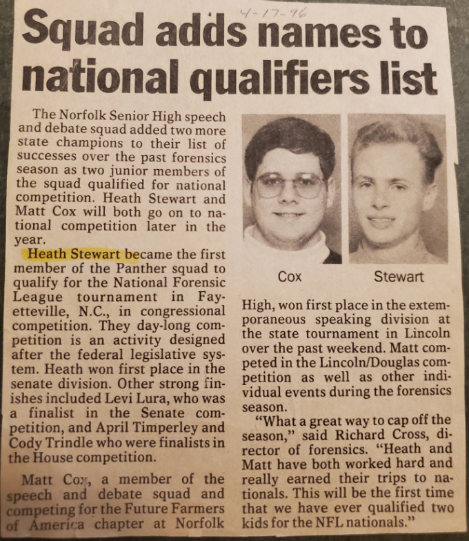

While going through some stuff my mom sent me, I found an old newspaper clipping from April, 17, 1996.
In high school, I was in the speech and debate squad and normally did Lincoln-Douglas debate,
as well as a couple different styles of speech competitions. On one of our state tournaments,
I decided to try congressional speech...and won!

I was the state champion and qualified for nationals in Fayetteville, NC.
It was a fun trip but pretty brutal with some of the large city competitors that had clearly done this before.
Everyone was trying to get in a speech just to win points, and as I watched some federal congressional debates,
I saw that seems to happen there too. That's how I experienced grandstanding, I suppose.

{: .cover-image}

<!-- cspell:ignore lura timperley trindle -->

> Squad adds names to national qualifiers list
>
> The Norfolk Senior High speech and debate squad added two more state champions to their list of successes over the past forensics season as two junior members of the squad qualified for national competition. Heath Stewart and Matt Cox will both go on to national competition later in the year.
>
> Heath Stewart became the first member of the Panther squad to qualify for the National Forensic League tournament in Fayetteville, N.C., in congressional competition. They day-long competition is an activity designed after the federal legislative system. Heath won first place in the senate division. Other strong finishes included Levi Lura, who was a finalist in the Senate competition, and April Timperley and Cody Trindle who were finalists in the House competition.
>
> Matt Cox, a member of the speech and debate squad and competing for the Future Farmers of America chapter at Norfolk High, won first place in the extemporaneous speaking division at the state tournament in Lincoln over the past weekend. Matt competed in the Lincoln/Douglas competition as well as other individual events during the forensics season.
>
> "What a great way to cap off the season," said Richard Cross, director of forensics. "Heath and Matt have both worked hard and really earned their trips to nationals. This will be the first time that we have ever qualified two kids for the NFL nationals."
